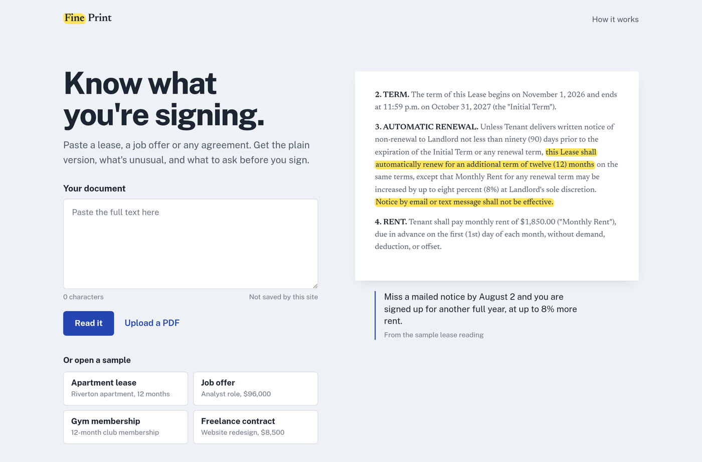
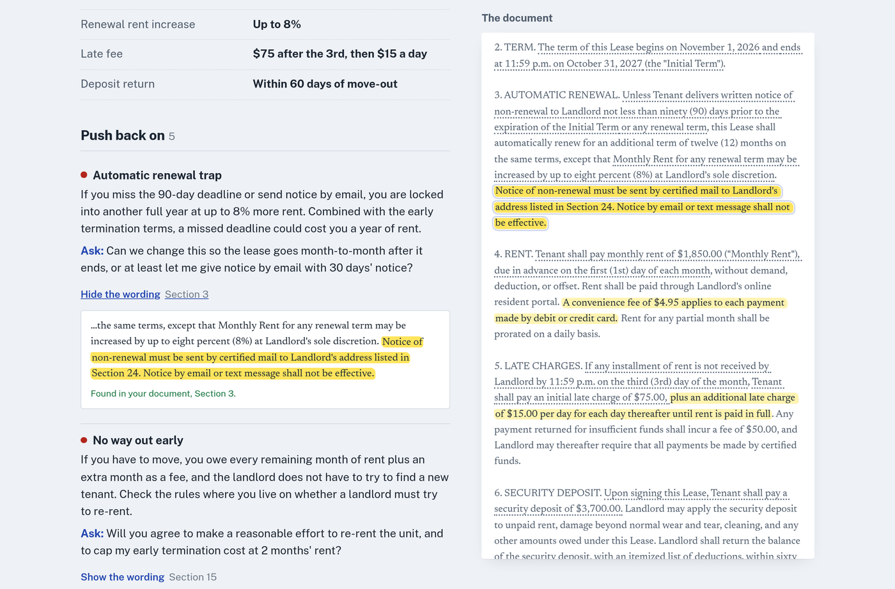

# Fine Print

Paste an agreement. Get the plain version, what is unusual, and what to ask before you sign.

**Live:** https://fineprint.meetdominic.me



## What a reading gives you

- **In plain words.** What the document is, who it is between, the money, and the one thing that matters most.
- **The numbers.** Rent, salary, fees, notice periods, limits.
- **Push back on.** Terms that are unusual or one-sided, each with a concrete thing to ask for.
- **Good to know.** Ordinary terms that should not surprise you later.
- **Dates.** Deadlines, with a one-tap calendar file.
- **Before you sign.** A short checklist.
- **Questions to send.** A ready message to the other side.



## Why the quotes can be trusted

Every point carries the exact words it is based on. Before anything is shown, the page searches the document for those words (ignoring case, curly quotes and line breaks) and highlights them. A point whose wording cannot be found is labelled as such. The sample readings match 96 of 96 quotes.

Highlights in the document follow importance: bright for push-back items, pale for good-to-know, a dotted underline for plain numbers and dates.

## How it is built

| Part | What it does |
|---|---|
| `src/worker.js`, `src/router.js` | Cloudflare Worker. Serves the page, `/api/meta`, and `/api/read`. |
| `src/reading/` | The prompt, the output schema (Zod), the Claude call, and the house-style checker. |
| `src/shared/quotes.js` | Quote finder and highlighter, shared by the Worker and the browser. |
| `src/limits.js` | Daily allowance per visitor and per day (Workers KV). |
| `public/` | The page. Plain HTML, CSS and ES modules. PDFs are read in the browser with pdf.js. |
| `samples/` | Four made-up documents and the script that produces their readings. |

The reading comes from Claude Opus 5.5 with structured output, so it always has the same shape. A refusal, a cut-off answer or an API error becomes a plain message on the page.

## Run it

```bash
npm install
npm run build
npx wrangler dev --var MOCK_ENGINE:1   # stand-in reader, no API key needed
```

Live reading needs Worker secrets: `ANTHROPIC_API_KEY`, and `ANTHROPIC_WORKSPACE_ID` for organisation-level keys. Without a key the samples work and live reading shows as paused.

## Tests

```bash
npm test        # quotes, server, engine, samples (each sample must match the current prompt and quote its document exactly)
npm run e2e     # phone (390x844, 360x640) and desktop walkthrough in light and dark, against a running dev server
```

## License

MIT
